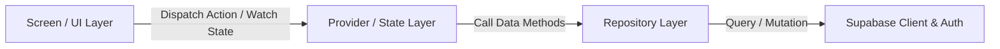

# Architecture Design — KosFinder

Dokumen arsitektur teknis KosFinder yang ringkas, modular, dan mematuhi prinsip KISS.

---

## 1. Komponen Aplikasi & Pola Arsitektur

Aplikasi menggunakan pola berlapis **Screen — Provider — Repository — Supabase Client**:



| Komponen | Peran & Tanggung Jawab | User Story Terkait |
| :--- | :--- | :--- |
| **Screen (UI)** | Menampilkan antarmuka pengguna, menangani input visual, validasi form awal, navigasi, dan merender state (loading, error ramah, data, empty state). Berorientasi tema hijau. | US01 s.d. US07 |
| **Provider (State)** | Mengelola *application & presentation state* menggunakan `ChangeNotifier`. Menerima aksi UI, memanggil Repository, serta memberitahu widget (`notifyListeners()`). | US01, US02, US04, US05, US06, US07 |
| **Repository** | Abstraksi akses data. Menangani mapping DTO/JSON ke Entity model Dart, normalisasi data (misal: nomor HP ke format `62...`), dan isolasi Supabase client. | US01, US02, US04, US05, US06, US07 |
| **Supabase Client** | SDK resmi Supabase untuk eksekusi Auth (Email & Password) dan operasi PostgreSQL (PostgREST) dengan token JWT sesi pengguna. | US01, US04, US05, US06, US07 |

---

## 2. Daftar Layar & Alur Navigasi

```mermaid
flowchart TD
    Splash[Splash / AuthGate] -->|Guest| Catalog[CatalogScreen]
    Splash -->|Authenticated Owner| Dashboard[OwnerDashboardScreen]
    Catalog -->|Pilih Item| Detail[KosDetailScreen]
    Catalog -->|Menu Pengembang| About[AboutScreen]
    Catalog -->|Akses Pemilik| Login[LoginScreen]
    Login <-->|Pindah Akun| Register[RegisterScreen]
    Login -->|Login Sukses| Dashboard
    Register -->|Daftar Sukses| Dashboard
    Dashboard -->|Tambah Kos| KosFormNew[KosFormScreen (Mode Add)]
    Dashboard -->|Edit Kos| KosFormEdit[KosFormScreen (Mode Edit)]
    Dashboard -->|Lihat Katalog Publik| Catalog
    Dashboard -->|Logout| Catalog
```

1. **`CatalogScreen` (Guest/Publik):** Katalog kos aktif, kolom pencarian teks (nama/area), filter gender (Putra, Putri, Campur), dan filter harga opsional (*US01, US02*).
2. **`KosDetailScreen` (Guest/Publik):** Detail kos, foto/placeholder fallback hijau, status ketersediaan, serta tombol WhatsApp (`https://wa.me/<nomor>`) (*US01, US03*).
3. **`AboutScreen` (Publik):** Informasi pengembang wajib: `2415051006 - I Putu Budha Aditya` (sesuai *AGENTS.md*).
4. **`LoginScreen` & `RegisterScreen` (Auth):** Formulir autentikasi pemilik kos menggunakan Email & Password tanpa verifikasi email (*US04*).
5. **`OwnerDashboardScreen` (Owner):** Pengelolaan kos pemilik (tab kos aktif dan tab arsip/nonaktif), statistik sisa kamar, dan tombol logout (*US05, US06, US07*).
6. **`KosFormScreen` (Owner):** Formulir tambah dan edit kos (nama, harga bulanan, tipe gender, alamat, nomor kontak, link gambar, sisa kamar) (*US05, US06*).

---

## 3. Rencana Database & Aturan Akses (RLS)

### 3.1 Skema Tabel `kos`

| Kolom | Tipe Data | Keterangan & Constraint |
| :--- | :--- | :--- |
| `id` | `UUID` | Primary Key, `DEFAULT gen_random_uuid()` |
| `owner_id` | `UUID` | Foreign Key ke `auth.users(id) ON DELETE CASCADE`, `NOT NULL` |
| `name` | `TEXT` | Nama kos, `NOT NULL` |
| `gender_type` | `TEXT` | `NOT NULL`, `CHECK (gender_type IN ('putra', 'putri', 'campur'))` |
| `price` | `BIGINT` | Harga sewa per bulan dalam Rupiah (angka murni), `NOT NULL`, `CHECK (price >= 0)` |
| `room_available` | `INTEGER` | Sisa kamar tersedia, `NOT NULL`, `DEFAULT 0`, `CHECK (room_available >= 0)` |
| `address` | `TEXT` | Alamat bebas / area kos, `NOT NULL` |
| `contact_number` | `TEXT` | Nomor kontak/WA berformat internasional (`62...`), `NOT NULL` |
| `image_url` | `TEXT` | Tautan gambar eksternal (nullable) |
| `is_active` | `BOOLEAN` | Status aktif/tampil di katalog publik (`DEFAULT true`). `false` = soft-deleted |
| `created_at` | `TIMESTAMPTZ`| Waktu pembuatan, `DEFAULT now()` |
| `updated_at` | `TIMESTAMPTZ`| Waktu pembaruan terakhir, `DEFAULT now()` |

### 3.2 Matriks Hak Akses & Aturan Row Level Security (RLS)

Row Level Security (RLS) diaktifkan secara ketat pada tabel `kos`:

- **SELECT (Melihat Data):**
  - Siapa saja (Guest / Anon) dapat melihat kos aktif: `is_active = true`.
  - Pemilik kos terautentikasi dapat melihat seluruh kos miliknya: `auth.uid() = owner_id` (baik aktif maupun soft-deleted/arsip).
- **INSERT (Menambah Data):**
  - Hanya pengguna terautentikasi (`auth.uid() IS NOT NULL`) yang dapat menambah kos dengan syarat `owner_id = auth.uid()`.
- **UPDATE (Mengubah Data & Soft Delete):**
  - Hanya pemilik baris bersangkutan yang boleh mengubah: `auth.uid() = owner_id`. Soft delete dilakukan dengan mengeset `is_active = false`.
- **DELETE (Menghapus Permanen):**
  - Dilarang untuk publik dan klien aplikasi (semua penghapusan via soft-delete). RLS hard delete dibatasi hanya ke `auth.uid() = owner_id` sebagai pengaman sekunder.

---

## 4. Konfigurasi Lingkungan (`--dart-define`)

Sesuai aturan keamanan `AGENTS.md`, dilarang menaruh kunci/URL di kode sumber (*no hardcoded secrets*). Aplikasi membaca konfigurasi saat kompilasi:

```dart
class AppConfig {
  static const String supabaseUrl = String.fromEnvironment('SUPABASE_URL');
  static const String supabaseAnonKey = String.fromEnvironment('SUPABASE_ANON_KEY');
}
```

Jalankan dan uji aplikasi secara lokal:
```bash
flutter run --dart-define=SUPABASE_URL=https://xyz.supabase.co --dart-define=SUPABASE_ANON_KEY=public-anon-key
```

---

## 5. Cara Rilis

### 5.1 Build APK Rilis
Jalankan build release Android berformat APK mandiri dengan menyuntikkan environment variables:
```bash
flutter build apk --release \
  --dart-define=SUPABASE_URL="https://YOUR_PROJECT_ID.supabase.co" \
  --dart-define=SUPABASE_ANON_KEY="YOUR_PUBLIC_ANON_KEY"
```
Hasil output berkas instalasi biner berada di: `build/app/outputs/flutter-apk/app-release.apk`.

### 5.2 GitHub Release
1. Pastikan seluruh kriteria DoD terpenuhi (`flutter analyze` dan `flutter test` lolos 100%).
2. Buat git tag versi sesuai semantic versioning pada `pubspec.yaml`:
   ```bash
   git tag -a v1.0.0 -m "Release v1.0.0 (TASK-XX)"
   git push origin v1.0.0
   ```
3. Buat Release baru pada repositori GitHub melalui GitHub CLI / antarmuka web GitHub, cantumkan changelog ringkas, dan lampirkan berkas `app-release.apk`.

---

## 6. Daftar Package yang Dibutuhkan & Relasi ke Story

| Package | Alasan Kebutuhan & Keterangan | Story Terkait |
| :--- | :--- | :--- |
| **`supabase_flutter`** | SDK resmi Supabase untuk Auth (Email/Password), Session Management, dan Query/Mutasi PostgreSQL via PostgREST dengan RLS terintegrasi. | US01, US04, US05, US06, US07 |
| **`provider`** | State management sederhana, resmi, dan mudah dirawat sesuai panduan arsitektur KISS di `AGENTS.md`. Memisahkan UI dan business logic. | Semua Story (US01-US07) |
| **`url_launcher`** | Membuka deep-link aplikasi WhatsApp atau tautan web `https://wa.me/<nomor>` dari detail kos. | US03 |
| **`intl`** | Pemformatan angka harga (`price` bertipe `BIGINT`) menjadi tampilan mata uang Rupiah Indonesia (misal: `Rp 850.000 / bulan`). | US01, US02, US05, US06 |
